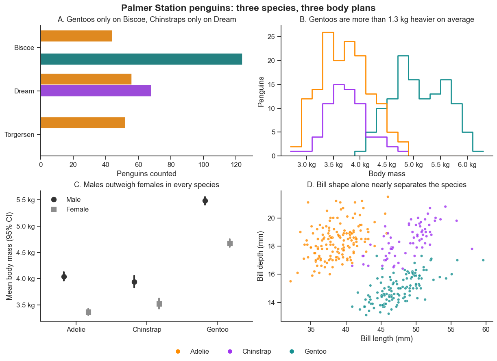

# 🐧 Seaborn with Penguins

A hands-on course that takes people who already know **Python and pandas** to making clear, honest, good-looking charts with **seaborn** and **matplotlib**. Seven short lessons use one dataset ([Palmer penguins](https://allisonhorst.github.io/palmerpenguins/)). Every example and exercise runs live in the browser.

**Live site:** https://acatlin.github.io/seaborn-penguins/



## What's inside

| | |
|---|---|
| **8 lesson pages** | Start here, plus 7 lessons: first plot, distributions, categories, relationships, small multiples, polish with matplotlib, and a capstone |
| **52 rendered figures** | Every figure is produced by the exact code shown beside it |
| **13 auto-graded exercises** | In-browser editor (Pyodide), **Run & check** with specific hints, and a hidden solution with its rendered chart |
| **28 quiz questions** | 4 per lesson, instant feedback with explanations, correct answers spread evenly across A-D |
| **Design thread** | "Design principle" callouts based on Stephen Few and Edward Tufte in every lesson: data-ink, common baselines, sorting, purposeful color, direct labels, small multiples |
| **Notebooks** | Student and solutions notebook for every lesson (`docs/notebooks/`), each with an *Open in Colab* link |
| **Assessment pack (.docx)** | 25 multiple-choice questions with answers marked and explained, an answer key, and 3 assignments of increasing difficulty with rubrics and tested model solutions. Instructor and student editions. |
| **Instructor guide** | Schedules, lesson-by-lesson talking points, common misconceptions, assessment mapping and troubleshooting ([on the site](https://acatlin.github.io/seaborn-penguins/instructor-guide.html) and as `.docx`) |
| **Mastery objectives (.xlsx)** | 38 objectives for a three-section course taught for mastery (static, interactive, dashboards). Every page section, exercise, quiz question, exam question and rubric row of this site is mapped onto the first fourteen, with a status, gaps, timings and next steps |

## Repository layout

```
content/            Lesson sources (Markdown + special code fences) and _site.yml (nav, repo info)
site_src/           Page template, CSS, quiz/nav JS (app.js), in-browser Python (live.js)
tools/
  runner.py         Runs one code cell and collects output/figures - shared by the build AND the browser
  build_site.py     content/ -> docs/ (HTML, figures, notebooks). Fails on any error, warning or bad exercise
  build_materials.py instructor/*.yaml + content/instructor-guide.md -> Word files and the objectives workbook
  build_objectives.py instructor/mastery_objectives.yaml + the lessons -> the workbook (run by build_materials.py)
instructor/         exam_questions.yaml, assignments.yaml, mastery_objectives.yaml, and the generated .docx and .xlsx files
docs/               GENERATED website served by GitHub Pages - don't edit by hand
data/penguins.csv   Bundled copy of the dataset (offline builds and the in-browser runtime)
tests/              pytest suite
```

## Build and test locally

```bash
python -m venv .venv && source .venv/bin/activate     # Windows: .venv\Scripts\activate
pip install -r requirements.txt

python tools/build_site.py          # regenerate docs/ (about 40 s; runs every cell)
python tools/build_materials.py     # regenerate the Word files and the objectives workbook in instructor/
python -m pytest                    # full test suite (about 90 s)
python -m http.server -d docs 8000  # preview at http://localhost:8000
```

### What the tests check

- Every example cell runs **without errors or warnings**, and every figure has alt text.
- Legends are titled in **plain English**, not with seaborn's raw column names. The four deliberate exceptions are listed, with reasons, in the test.
- The bin-width figure in Lesson 2 draws exactly the widths its panel titles name, and each of its panels labels its own y-axis.
- Every exercise's **solution passes its checker**, and the **untouched starter does not**, so checks can't be vacuous. Exercise 2.1's near misses (bars, filled steps, a density curve, an ECDF, a missing axis label) must each earn a hint. No exercise that asks for plain-English axis labels accepts seaborn's raw column names, and none that asks for `PENGUIN_COLORS` accepts seaborn's default colors.
- Every lesson's **solutions notebook executes** top to bottom in a real Jupyter kernel, and **no cell leaves the theme or any other global setting changed** for the cells after it, so notebooks draw what the site shows.
- All internal links, anchors, images and scripts resolve, and no template or Markdown leaks into the HTML. Design callouts become blockquotes in the notebooks, and every quiz question is a labeled group for screen readers. The muted label color keeps at least 4.5:1 contrast on every background it sits on, in both themes.
- Every page, notebook, script, stylesheet and data file in `docs/` **matches what the sources produce**, every figure is present, and no leftover figures or notebooks remain, so a stale site can't be committed. (PNG bytes are not compared: they differ between the machine that builds `docs/` and the CI runner.)
- Quiz and exam answers are **evenly distributed across A-D**. There are no runs of three identical answers, and the correct option is rarely the longest (36% or less).
- The exam covers all 7 lessons. The rubrics total 100 and both editions state the scoring scale. The instructor edition marks exactly the right answers, and the student edition contains no answers or solutions.
- The **mastery objectives** map names only page sections, exercises, questions and rubric rows that exist, and leaves none out. The committed workbook matches its sources, and every formula in it has its result stored in the file. The statuses, counts and hours quoted in the instructor guide match the workbook. Mastery of an objective never waits for an exercise on a page later than the first page that teaches an objective needing it.

## Authoring lessons

Lessons are Markdown with a few special code fences:

````markdown
```python setup                         <- runs before every cell on the page (shown once)
```python run fig=NAME alt="..."        <- executed at build time; code + figure shown, "Edit & run" in browser
```python exercise id=2.1 title="..."   <- starter code in a live editor
```python solution for=2.1              <- hidden solution (rendered with its figure)
```python check for=2.1                 <- assertions that grade the exercise (helpers: chart_axes, points,
                                            legend_labels, colors_used, near_color)
```quiz                                 <- YAML list of {q, options[4], answer: A-D, explain}
````

Callouts use Markdown admonitions: `!!! few "Title"` (design principle), `!!! warning`, and `!!! note`. In the generated notebooks they become blockquotes with a bold label. Every setup cell defines the two fixed palettes, `PENGUIN_COLORS` (species) and `SEX_COLORS` (two grays), so the same thing has the same color on every chart. Seaborn titles a legend with the raw column name, so finished charts relabel it: `ax.get_legend().set_title("Species")`, or `g.legend.set_title(...)` on a figure-level grid.

## Branches and workflow

| Branch | Purpose |
|---|---|
| `main` | Published. GitHub Pages serves `docs/` from this branch. Protected: CI must pass, no force-pushes. |
| `develop` | Integration branch for edits. Open a PR into `main` to publish. |
| `feature/*` | Optional short-lived branches off `develop`. |

CI (`.github/workflows/ci.yml`) installs the pinned requirements and runs the full test suite on every push and PR to `main` or `develop`.

## Using this for a class

See the [instructor guide](https://acatlin.github.io/seaborn-penguins/instructor-guide.html). **Note:** this repository is public, so the answer keys in `instructor/` are public too. For graded use, keep a private copy of the assessment materials or modify the questions.

## Credits and license

- Data: Gorman KB, Williams TD, Fraser WR (2014). *Ecological sexual dimorphism and environmental variability within a community of Antarctic penguins (genus Pygoscelis).* PLoS ONE 9(3): e90081. Distributed via [palmerpenguins](https://allisonhorst.github.io/palmerpenguins/) (CC0).
- In-browser Python: [Pyodide](https://pyodide.org/).
- Design principles: Stephen Few, *Show Me the Numbers*; Edward Tufte, *The Visual Display of Quantitative Information*.
- Code is MIT-licensed. Lesson text and teaching materials are CC BY 4.0. See [LICENSE](LICENSE).
